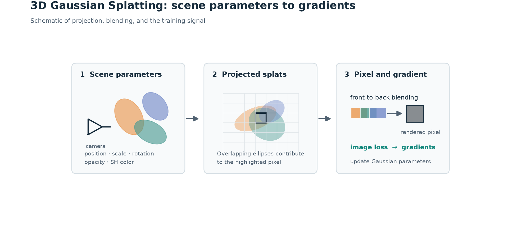
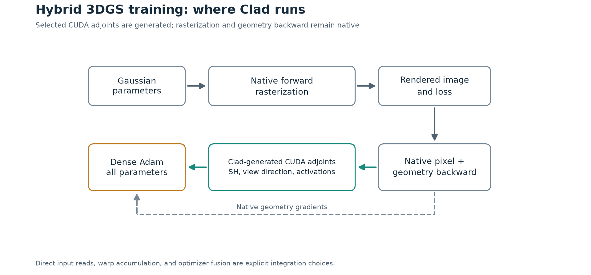
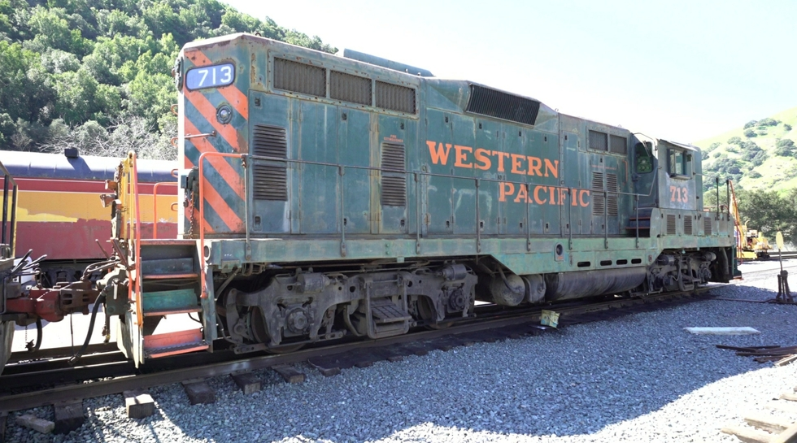
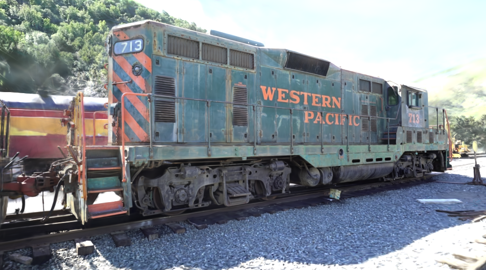
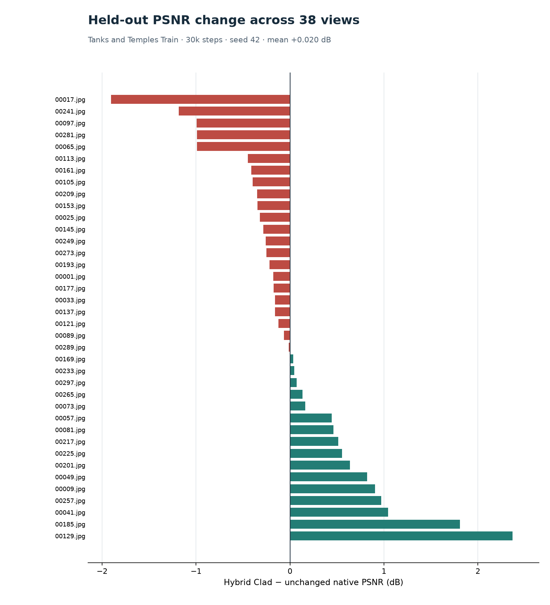
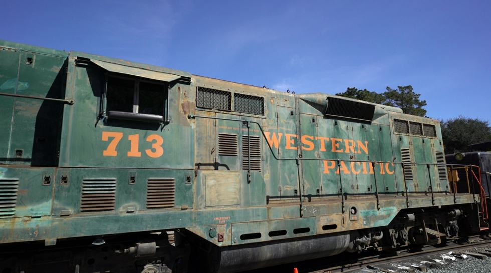
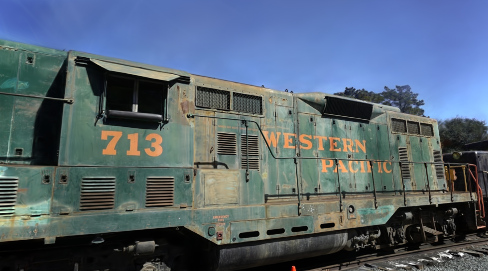
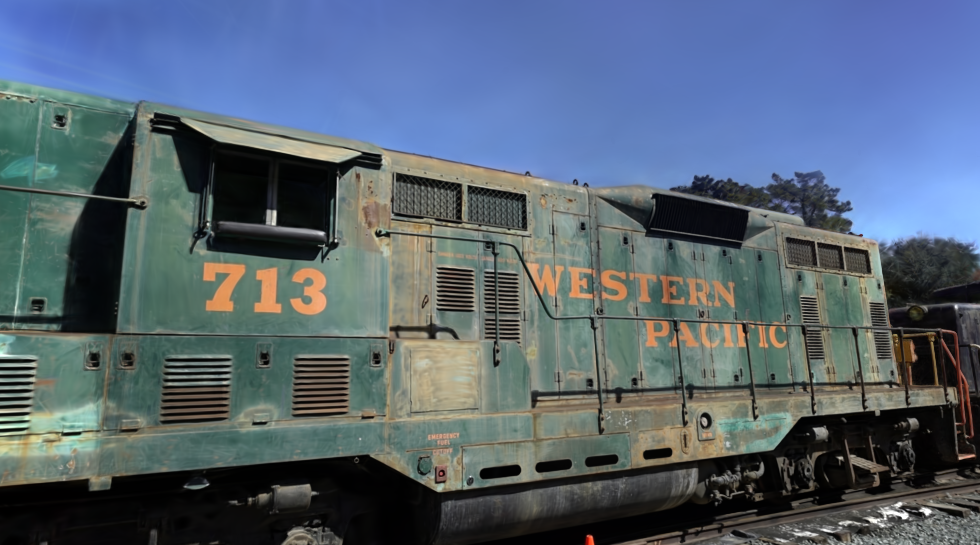

# Rendered results

These images replay the saved 30,000-iteration Tanks and Temples Train/seed-42
checkpoints used in the [recorded comparison](../../results/README.md). They
show the same held-out cameras through the original native renderer and the
combined Clad integration. The replay performed forward rendering only; it
did not retrain or update either model. Displayed RGB is clamped to [0, 1];
PSNR was computed from the original floating-point renders.

## What 3DGS renders

This schematic shows the core idea of [3D Gaussian Splatting](https://repo-sam.inria.fr/fungraph/3d-gaussian-splatting/):
scene Gaussians project to overlapping elliptical footprints, which contribute
to image pixels. Image loss supplies gradients for training the Gaussian
parameters. It is an explanatory diagram, not a measured render.

## Where Clad runs

The green path contains generated SH, view-direction, and activation adjoints.
The pixel and geometry backward pass stays native; geometry gradients also
reach the optimizer directly. The scheduling choices in the figure are
explicit integration work, not automatic compiler fusion.

## Matched-camera walkthrough

[Watch the 7.7-second target/native/hybrid comparison](train-matched-cameras.mp4).
It visits all 38 held-out cameras in filename order. Each frame compares the
same camera's photograph, original native render, and hybrid render with
Clad-generated adjoints. Both models are the distinct saved 30k checkpoints;
the clip is a forward-only replay, not a training animation. Frames are resized
for display. [Video provenance](video-provenance.json) records the camera order,
checkpoint and renderer hashes, and zero backward or optimizer calls.

## A central held-out view

`00121.jpg` is one of the two central views when the 38 held-out cameras are
ranked by PSNR change (rank 20/38). Its PSNR is 0.12 dB lower with the hybrid.
The three PNGs below are unannotated, full-size exports of the same camera.

| Target photograph | Original native | Hybrid Clad integration |
| :---: | :---: | :---: |
|  |  |  |

## Quality variation

Mean held-out PSNR changed from 22.256 to 22.276 dB. Individual changes range
from -1.90 to +2.37 dB. The chart shows all 38 views, including the central
view above; the small mean change does not establish better quality on every
view.

The largest PSNR regression is `00017.jpg` (-1.90 dB):

| Target photograph | Original native | Hybrid Clad integration |
| :---: | :---: | :---: |
|  |  |  |

Regenerate the figures from [`results/held-out-views.csv`](../../results/held-out-views.csv)
with `python docs/visuals/plot_psnr.py`,
`python docs/visuals/plot_pipeline.py`, and
`python docs/visuals/plot_splats.py` after installing Matplotlib. The
[quickstart](../../QUICKSTART.md#render-and-evaluate) explains how to render
a saved model. Its [dataset-free smoke test](../../QUICKSTART.md#smoke-test)
exercises training, checkpoint resume, and saved-model rendering on procedural
inputs.
